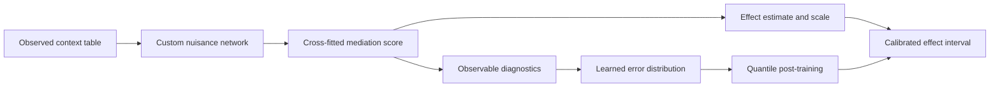

# MediPFN

**Amortized In-Context Nuisance Learning and Inference for Causal Mediation Analysis**

Shi Bo · Boston University

[Paper: arXiv:2611.13219](https://arxiv.org/abs/2611.13219) ·
[Arena model and inference](arena_n500/README.md)

MediPFN estimates a natural indirect effect and its uncertainty from an observed
table. The current meeting-run model combines a frozen TabPFN-v3 backbone, a
mediation adapter, a cross-fitted score, a supervised fine-tuned error head and
independent calibration. Earlier custom-backbone research models are retained
in the repository.

[Arena model and inference](arena_n500/README.md) ·
[Arena model card](arena_n500/MODEL_CARD.md) ·
[Arena results](ARENA_RESULTS.md) ·
[v1 model card](MODEL_CARD.md) · [v2 model card](MODEL_CARD_V2.md) ·
[V3 adaptations](MODEL_CARD_V3_ADAPTATIONS.md) ·
[Checkpoints](CHECKPOINTS.md) · [Reproducibility](REPRODUCIBILITY.md) ·
[Shared evaluation](evaluation/v2_shared_20261103/README.md) · [Status](STATUS.md)

## Versions

| Version | Model and data | Current status |
|---|---|---|
| **Arena meeting run** | Frozen TabPFN-v3 with mediation adapter; n=500 | Adapter, SFT error head and calibration archived; 1,000 ID and 1,000 source-OOD tables evaluated |
| **v1** | Retained custom MediPFN production pipeline | Code, seven checkpoint files, normalization/calibration records and verified aggregate results archived; restore check passed |
| **v2** | New custom backbone and a richer literature-derived mediation simulation bank | All three routes trained and archived; shared 1,152-table evaluation complete and independently verified; ID gains and composition-OOD undercoverage reported |

The versions are stored separately. The Arena meeting run uses its own
checkpoint and evaluation protocol. The published arXiv manuscript describes
the earlier paper model; the Arena results belong to a subsequent experiment.

## Arena meeting-run quick start

The meeting-run predictor accepts one observed table with 500 rows and returns
the NIE estimate, standard error, and 90%, 95% and 99% intervals. The selected
adapter, SFT head and calibration are included in `arena_n500/checkpoints/`.
Obtain the two official TabPFN-v3 classifier and regressor weights separately
from [Prior Labs](https://huggingface.co/Prior-Labs/tabpfn_3), and use them
under the accompanying license.

```sh
git clone https://github.com/shibo769/MediPFN.git
cd MediPFN/arena_n500
pip install -r requirements-research.txt
python predict.py --observed example/observed_n500.npz \
  --classifier /path/to/tabpfn-v3-classifier-v3_default.ckpt \
  --regressor /path/to/tabpfn-v3-regressor-v3_default.ckpt \
  --device cpu --output prediction.json
```

Input fields, checkpoint bindings, reproducibility and licensing are documented
in the [Arena inference guide](arena_n500/README.md) and
[model card](arena_n500/MODEL_CARD.md). The meeting-run fitting budget was
20,000 distinct tables, with an additional independent calibration set. On
the held-out 1,000 ID and 1,000 source-OOD tables, 95% coverage and mean
interval length were 95.39% / 0.5519 and 97.90% / 2.0203, respectively.
The source-OOD split holds out two source families from mediation-specific
fitting and calibration; upstream TabPFN exposure is unknown. These are
single-method results, and the same-table baselines remain to be evaluated.

## Earlier research models

Verify the trained v2 research prototype with the Python standard library:

```sh
git clone https://github.com/shibo769/MediPFN.git
cd MediPFN
python v2/predict.py --verify-only
```

With the recorded NumPy/PyTorch environment and an observed-table NPZ file:

```sh
python v2/predict.py --data observed_table.npz --output interval.json
```

The file contains numeric `x`, `a`, `m`, `y` arrays and optional string feature
types. Inference verifies four selected checkpoint files, final calibration
and 68 bound source files before loading. See the
[v2 inference guide](v2/README.md#primary-model-inference).

For the retained first-version pipeline:

```sh
git clone https://github.com/shibo769/MediPFN.git
cd MediPFN
python v1/restore.py --verify-only
```

This standard-library check verifies every retained production source/asset
against its SHA-256 manifest. For an environment with NumPy, PyTorch, SciPy and
scikit-learn installed:

```sh
python v1/restore.py --smoke
```

The smoke check restores the actual v1 weights and produces intervals on a new
synthetic table. It is a loading/inference check, not a coverage benchmark.
[Reproducibility instructions](REPRODUCIBILITY.md) include dependency guidance
and a Python inference example.

## Earlier custom-backbone inference pipeline



Deployment uses fixed weights and observable context data. Known synthetic
effects are used in offline error training and evaluation, not supplied as
features at inference. Causal interpretation requires the stated identification
and overlap assumptions.

## Checkpoints and results

All seven retained v1 `.pt` files are included directly in the repository. The
[checkpoint index](CHECKPOINTS.md) gives their roles, locations and full
SHA-256 values. The [manifest](v1/manifest.json) binds 97 actual production
source/asset files; the weights were downloaded back from GitHub and checked
against the original SCC hashes after the initial push.

The completed shared-bank evaluation contains 2,952 tables. At 95% nominal
coverage, retained MediPFN coverage/mean interval length is 96.67%/0.4348 in
distribution and 92.95%/0.4921 with real covariates and simulated responses.
The [full aggregate and paired tables](v1/results) retain all settings and
failure counts. Coverage gains should be assessed together with interval
lengths and the scope of each comparison.

## Rich-simulation v2

The new bank adapts 15 registry records into 14 distinct complete-data presets.
Entire Eric and Xia-Chan provenance families are reserved for source OOD;
Jones NNN is reserved for composition OOD. Held-out sources are excluded from
training, development selection and calibration. The bank uses a common
superpopulation natural indirect effect target, with each adaptation and truth
calculation documented in [the generator guide](v2/dgp/README.md).

Factual nuisance pretraining completed under SCC job `8425910`: 20,000 optimizer
steps and 160,000 training-table draws across all eight training families. The
selected checkpoint is from step 17,000, with same-source DEV factual loss
1.526461. Its [checkpoint and provenance](v2/checkpoints/factual/manifest.json)
are archived separately from the v1 assets. The nested-regression stage also
completed 5,000 steps and 40,000 training-table draws; its selected DEV loss is
0.229999. Both checkpoints passed a joint cross-fitted inference restoration
check. Signed-error learning, confidence-guided post-training and fresh
ID task-mixture calibration are also complete. The
[final bundle](v2/checkpoints/primary/bundle.json) preserves completion records
and exact asset identities. This primary prototype uses one ordered
signed-error head; it does not reuse the v1 mixture-of-experts construction.
The [shared evaluation](evaluation/v2_shared_20261103/results/README.md) is
complete and independently verified on 1,152 paired tables. At the 95% level,
custom v2 has 95.99% ID coverage with shorter intervals and about 21–24 times
lower per-table inference time than the two V3 routes. Its source-OOD intervals
are wider, and composition-OOD coverage is 73.96%, versus 92.71% for both V3
routes. The full results retain these adverse findings and paired uncertainty.

The frozen factual/nested source release is identified by
`65fff8193cab74881e14a3262c254578255a78d2f6ca56aa4d7f6086a25ed36d`.
The [current error-pipeline release](v2/release_manifest.json) preserves those
source bytes and adds explicit estimator/feature/checkpoint bindings.
Optional [pretrained-backbone experiments](v2/OPTIONAL_BACKBONES.md) use a
separate pinned implementation. The frozen-V3 NIE head and fresh calibration
are complete and [archived](v2/checkpoints/frozen_v3/manifest.json), with actual
accounting and full CPU restoration verified. The cross-task V3 adapter and
its own NIE head/calibration are also [complete and archived](v2/checkpoints/adapter_v3/manifest.json).
Their separate training/restoration records are complemented by the
[verified shared scientific results](evaluation/v2_shared_20261103/results/README.md).
See [v2/README.md](v2/README.md), [protocol](v2/protocol.json), and
[release manifest](v2/release_manifest.json). Learned-error training,
post-training, fresh calibration and final evaluation are separate stages.

## Repository layout

```text
MODEL_CARD.md          Retained model, evaluation and use scope
MODEL_CARD_V2.md       New model, source split and training status
STATUS.md             Verified run progress and remaining stages
CHECKPOINTS.md         Checkpoint roles and SHA-256 index
REPRODUCIBILITY.md     Verification, restoration and training source map
v1/
  manifest.json       Frozen production file identities
  restore.py          Portable, verified inference wrapper
  project/            Original source and retained model assets
  results/            Verified aggregate and paired comparison tables
v2/
  protocol.json       Frozen simulation split and training design
  release_manifest.json
  model.py            New nuisance backbone
  train.py            Factual pretraining entry point
  train_nested.py     Nested-regression stage
  run_error_pipeline.py  Error learning, post-training and fresh calibration
  error_binding.py    Observed-table and checkpoint identity checks
  manifests/          Separate factual, error and optional source identities
  tabular_backbones/  Optional pretrained-backbone adaptations and tests
  dgp/                Adapted generators, tests and upstream provenance
```

## License and provenance

The repository currently has no blanket redistribution license.
Vendored upstream generator materials retain their Apache-2.0
[license](v2/dgp/vendor/LICENSE) and [notice](v2/dgp/vendor/NOTICE.md).
The Arena inference package includes the applicable TabPFN-3 license and notice;
the official pretrained weights are subject to their own terms.
Raw study datasets, raw test banks, authentication material, temporary
environments and third-party TabPFN weights are not redistributed here.

## Citation

```bibtex
@article{bo2026medipfn,
  title={MediPFN: Amortized In-Context Nuisance Learning and Inference for Causal Mediation Analysis},
  author={Bo, Shi and Hu, Jiaming},
  journal={arXiv preprint arXiv:2611.13219},
  year={2026}
}
```
