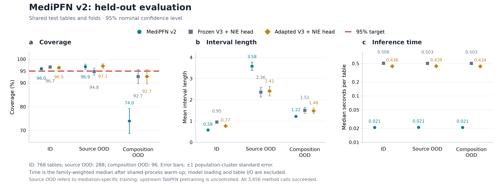

# Verified shared evaluation results

**Complete and independently verified: 2026-11-04.** All 96 array tasks,
summary job `8427084` and independent audit `8427085` have actual scheduler
`failed=0`, `exit_status=0`. All 3,456 method attempts succeeded on 1,152 shared
tables, giving 10,368 intervals at the prespecified 90%, 95% and 99% levels.
The independent auditor recomputed all 1,008 metric cells and 1,008 paired cells.

## Primary 95% results

| Stratum | Route | Coverage (%) | Mean interval length | Median inference (s) |
|---|---|---:|---:|---:|
| Same-source ID | Custom MediPFN v2 | 95.99 | 0.5816 | 0.02093 |
| Same-source ID | Frozen V3 + NIE head | 96.72 | 0.9547 | 0.50566 |
| Same-source ID | Adapted V3 + NIE head | 96.46 | 0.7691 | 0.43598 |
| Source OOD | Custom MediPFN v2 | 96.88 | 3.5826 | 0.02106 |
| Source OOD | Frozen V3 + NIE head | 94.79 | 2.3635 | 0.50308 |
| Source OOD | Adapted V3 + NIE head | 97.14 | 2.4139 | 0.43901 |
| Composition OOD | Custom MediPFN v2 | 73.96 | 1.2235 | 0.02089 |
| Composition OOD | Frozen V3 + NIE head | 92.71 | 1.5074 | 0.50277 |
| Composition OOD | Adapted V3 + NIE head | 92.71 | 1.4832 | 0.43405 |

Custom v2 has the shortest ID intervals: 39.1% shorter than
frozen V3 and 24.4% shorter than adapted V3. ID coverage is
95.99%, 96.72% and 96.46%, respectively. Ratios of weighted median ID inference
times are 24.2 and 20.8 in favor of custom v2.
These are synchronized, already-loaded per-table inference comparisons on the
shared L40S protocol, not cold-start or end-to-end cluster turnaround ratios.

The OOD findings differ. Custom v2's source-OOD intervals are wider than both
V3 routes. On the Jones NNN composition holdout, its coverage is 73.96%, versus
92.71% for each V3 route; all three are below the 95% target there. The shorter
custom composition intervals therefore do not establish better inference.
This evaluation does not support a universal best-model claim.

## Paired uncertainty

| Stratum | Custom minus comparator | Coverage difference (pp) ± cluster SE | Length difference ± cluster SE |
|---|---|---:|---:|
| Same-source ID | Frozen V3 + NIE head | -0.74 ± 0.95 | -0.3731 ± 0.0437 |
| Same-source ID | Adapted V3 + NIE head | -0.47 ± 0.96 | -0.1875 ± 0.0237 |
| Source OOD | Frozen V3 + NIE head | +2.08 ± 1.88 | +1.2191 ± 0.1204 |
| Source OOD | Adapted V3 + NIE head | -0.26 ± 1.59 | +1.1687 ± 0.1277 |
| Composition OOD | Frozen V3 + NIE head | -18.75 ± 5.39 | -0.2839 ± 0.1636 |
| Composition OOD | Adapted V3 + NIE head | -18.75 ± 5.78 | -0.2597 ± 0.1420 |

Differences use the same observed tables and folds. Standard errors cluster
by the active structural population and center within allocation strata;
they are standard errors, not confidence-interval half-widths. The full
[`paired.csv`](paired.csv) also reports conditional table-draw Monte Carlo
standard errors, jointly successful denominators and paired timing ratios.
Small single-source/size cells can lack enough distinct populations for a
cluster standard error; missing entries are retained.

## Files and interpretation

* [`metrics.csv`](metrics.csv): every prespecified stratum, source family,
  preset and sample-size summary at all three levels, including coverage,
  interval length, interval score, bias, RMSE, failure counts and timing.
* [`paired.csv`](paired.csv): all method pairs, paired differences and
  structural-population uncertainty; no unfavorable comparison is removed.
* [`startup.csv`](startup.csv): 288 shard-route load/bootstrap records.
  Routes share one CUDA process/file cache; these are not three independent
  cold-process experiments.
* [`failures.json`](failures.json): the complete empty method-failure list.
* [`summary_audit.json`](summary_audit.json),
  [`independent_audit.json`](independent_audit.json) and
  [`verification.json`](verification.json): successful accounting, immutable
  model/source/bank/output bindings and independent endpoint recomputation.
* [`overview_zh.md`](overview_zh.md): Chinese reading guide.

Bank weights balance families, presets and sample sizes as frozen in the
protocol; they need not equal unweighted table proportions. Coverage includes
all attempts; a method failure would count as a miss. Lengths and point-error
metrics condition on successful attempts, with denominators retained. Here all
attempts succeeded. The 576 structural populations produced two row replicates
each; 768 tables are ID, 288 source OOD and 96 composition OOD.

Timing includes observed-data preprocessing, context fitting, cross-fitting,
scores, the learned error head and fixed calibration. It excludes raw bank I/O,
truth/metric computation, model loading and the fixed non-test bootstrap.
Model initialization/training budgets differ. Source holdouts apply to our
mediation-specific fitting, DEV and calibration, not to the inherited official
V3 pretraining distribution. No model or calibration was selected from these
tests. OOD measurements do not extend the iid ID calibration guarantee.

These files contain aggregate results and provenance only. Raw NPZ test tables,
per-case truth/endpoints, full task seeds, raw shards and authenticated
transport receipts are excluded. The frozen source and hash/count bank index
remain in the [parent directory](../README.md).

A byte-verified aggregate-only archive is available in the
[evaluation release](https://github.com/shibo769/MediPFN/releases/tag/v2-shared-evaluation-20261104).
The [nine-point plot data](overview95.csv) and [plot binding](overview.metadata.json)
are derived from the verified primary-level aggregate cells.
