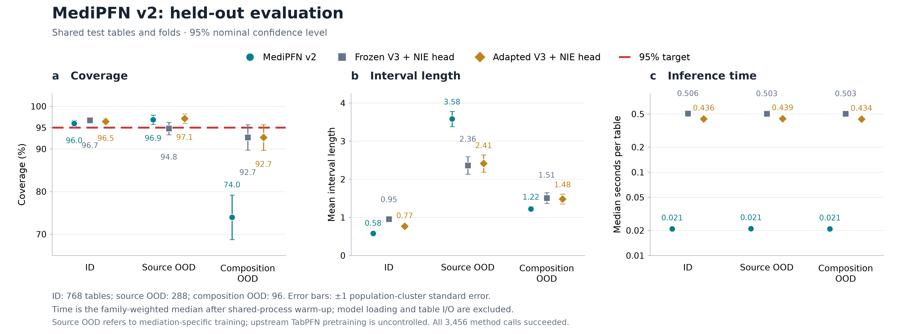

# 三条路线的共同测试结果

本次测试已完成实际作业账目核验、模型／源码／测试表身份核验，以及独立重算审计。
共 1,152 张测试表、576 个不同结构总体；三条路线均在同一张表、同一分折上推断。
3,456 次方法调用全部成功，90%／95%／99% 三个水平共 10,368 个区间，失败数为零。

下面是主要的 95% 水平结果。数值从完整 CSV 自动提取；覆盖率使用预先冻结的
机制族／预设／样本量平衡权重，不一定等于直接数覆盖表的比例。

| 分组 | 方法 | 覆盖率 (%) | 平均区间长度 | 单表推断中位数 (秒) |
|---|---|---:|---:|---:|
| Same-source ID | Custom MediPFN v2 | 95.99 | 0.5816 | 0.02093 |
| Same-source ID | Frozen V3 + NIE head | 96.72 | 0.9547 | 0.50566 |
| Same-source ID | Adapted V3 + NIE head | 96.46 | 0.7691 | 0.43598 |
| Source OOD | Custom MediPFN v2 | 96.88 | 3.5826 | 0.02106 |
| Source OOD | Frozen V3 + NIE head | 94.79 | 2.3635 | 0.50308 |
| Source OOD | Adapted V3 + NIE head | 97.14 | 2.4139 | 0.43901 |
| Composition OOD | Custom MediPFN v2 | 73.96 | 1.2235 | 0.02089 |
| Composition OOD | Frozen V3 + NIE head | 92.71 | 1.5074 | 0.50277 |
| Composition OOD | Adapted V3 + NIE head | 92.71 | 1.4832 | 0.43405 |

ID 中，custom v2 的覆盖率接近目标，区间比 frozen V3 短 39.1%，
比 adapted V3 短 24.4%；按加权推断时间中位数之比，分别快
24.2 倍、20.8 倍。
但不能据此说 custom 在所有情况下最好：source OOD 下它的区间更宽；
composition OOD 下覆盖率只有 73.96%，两条 V3 路线均为 92.71%，也仍低于 95%。
custom 在这一组更短的区间伴随明显欠覆盖，属于需要保留的不利结果。

配对差异为 custom 减比较方法；± 后是按结构总体聚类的标准误，不是置信区间：

| Stratum | Custom minus comparator | Coverage difference (pp) ± cluster SE | Length difference ± cluster SE |
|---|---|---:|---:|
| Same-source ID | Frozen V3 + NIE head | -0.74 ± 0.95 | -0.3731 ± 0.0437 |
| Same-source ID | Adapted V3 + NIE head | -0.47 ± 0.96 | -0.1875 ± 0.0237 |
| Source OOD | Frozen V3 + NIE head | +2.08 ± 1.88 | +1.2191 ± 0.1204 |
| Source OOD | Adapted V3 + NIE head | -0.26 ± 1.59 | +1.1687 ± 0.1277 |
| Composition OOD | Frozen V3 + NIE head | -18.75 ± 5.39 | -0.2839 ± 0.1636 |
| Composition OOD | Adapted V3 + NIE head | -18.75 ± 5.78 | -0.2597 ± 0.1420 |

完整的 90%／99%、不同机制族、预设、样本量、点估计误差和配对不确定性均保存在
metrics.csv 与 paired.csv，没有只选有利分组。缺少足够不同总体时，聚类标准误留空。
单表时间包含数据预处理、上下文拟合、交叉拟合、score、误差模型和固定校准，
不含读测试表、计算真值／指标、加载模型或固定预热。startup.csv 另存加载／预热；
这些记录共享 CUDA 进程与文件缓存，不能当作三次独立冷启动。

Source OOD 只保证这些来源没有进入我们的中介训练、DEV 和校准；
官方 V3 上游预训练是否覆盖这些机制形式并不由本实验控制。
本次没有用测试结果选模型或重新校准，也没有建立任意 OOD 覆盖保证。
第一版论文、实验、用户提供的参考文献均未因此次归档修改。
